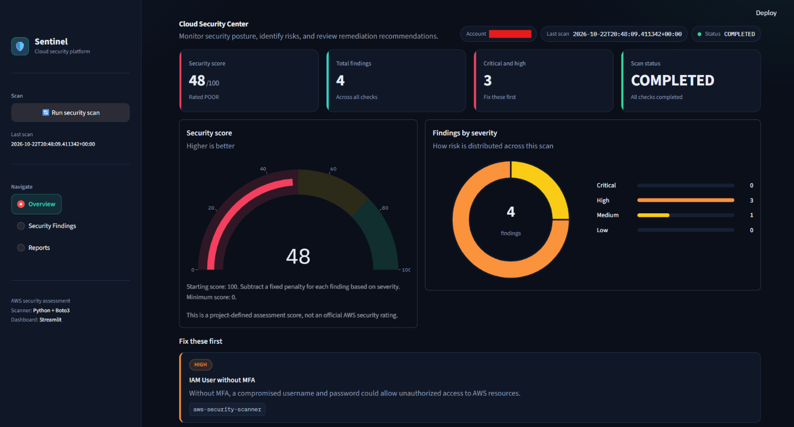
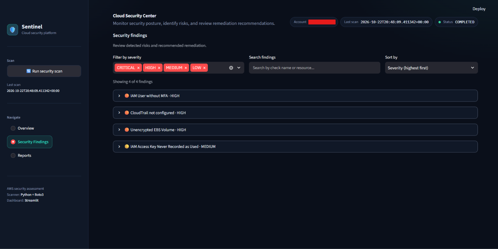
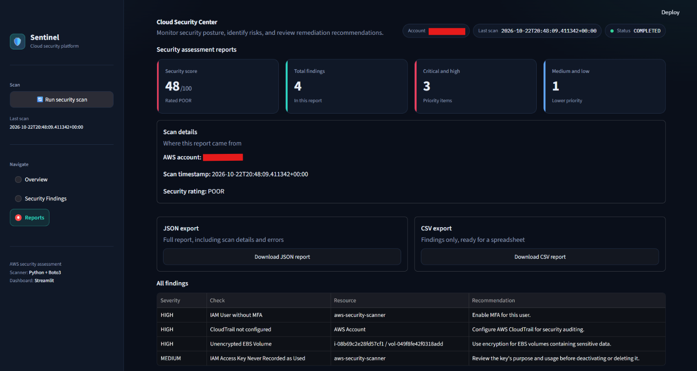
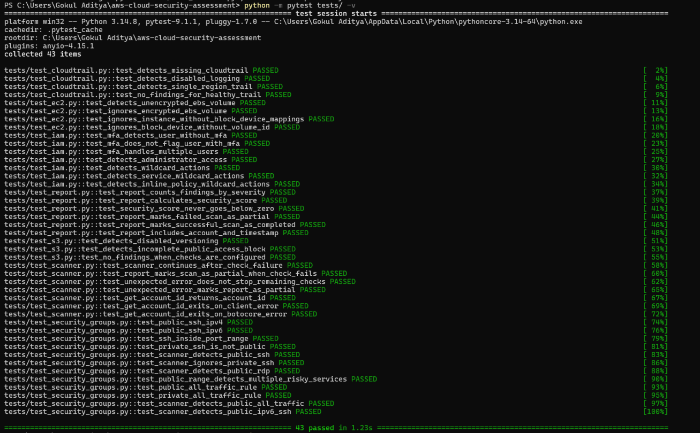

# 🛡️ AWS Cloud Security Assessment Tool

A Python-based AWS security assessment tool that identifies common cloud security misconfigurations, assigns severity levels, and presents findings through an interactive Streamlit dashboard.

The project demonstrates practical cloud security concepts, including IAM security, network exposure analysis, storage encryption, and security monitoring configuration.

## 🎯 Project Objectives

- Identify common security misconfigurations in AWS environments.
- Highlight potentially excessive IAM permissions and exposed network services.
- Explain security findings and provide remediation recommendations.
- Generate structured security reports for further analysis.
- Demonstrate automated security assessment using Python and Boto3.

## 🖥️ Dashboard Preview

### 1. Security Overview
View the overall security score, severity distribution, and priority findings.



### 2. Security Findings
Filter findings by severity, search for resources, and review remediation recommendations.



### 3. Assessment Reports
Review assessment summaries and export findings in JSON or CSV format.



## ✨ Features

### Identity and Access Management (IAM)
- Detect IAM users without MFA.
- Identify users with `AdministratorAccess`.
- Detect wildcard actions, including `*` and service-level wildcards such as `s3:*`, in supported IAM policies.
- Review IAM access-key usage information.

### Network Security
- Detect publicly exposed SSH and RDP services.
- Identify security group rules allowing unrestricted traffic.
- Evaluate supported IPv4 and IPv6 ingress rules.

### Storage Security
- Check S3 public-access protection and encryption configurations.
- Identify unencrypted EBS volumes.

### Security Monitoring
- Check AWS CloudTrail configuration.

### Reporting and Dashboard
- Assign severity levels to findings.
- Generate remediation recommendations.
- Calculate a project-defined security score.
- Save scan results as JSON.
- Visualize findings through a Streamlit dashboard.
- Download supported reports in JSON and CSV formats.
- Report scan errors and incomplete assessments.


## 🧰 Technology Stack

| Technology | Purpose |
|---|---|
| Python | Scanner implementation |
| Boto3 | AWS API integration |
| AWS CLI | AWS identity and credential configuration |
| AWS IAM | Scanner permissions and identity assessment |
| Amazon EC2 | Compute and EBS security assessment |
| Streamlit | Interactive dashboard |
| Plotly | Data visualization |
| JSON | Structured security reports |
| Pytest | Automated testing |

## 🏗️ Architecture

The assessment workflow follows these steps:

1. **AWS authentication:** Boto3 obtains credentials from the configured AWS credential provider.
2. **Security checks:** Individual modules inspect supported AWS configurations.
3. **Finding generation:** Detected issues are recorded with severity levels and recommendations.
4. **Error handling:** The scanner records check failures and continues with other checks where possible.
5. **Report generation:** Results, severity counts, and scan status are assembled into a JSON report.
6. **Dashboard visualization:** Streamlit presents the saved assessment results.
7. **Report export:** Users can download reports in supported formats.


## 📁 Project Structure

```text
aws-cloud-security-assessment/
├── scanner.py
├── dashboard.py
├── requirements.txt
├── README.md
├── .gitignore
├── checks/
│   ├── iam.py
│   ├── s3.py
│   ├── security_groups.py
│   ├── cloudtrail.py
│   └── ec2.py
└── tests/
    ├── test_iam.py
    ├── test_scanner.py
    └── test_security_groups.py
```

The `reports/` directory is created when scan results are saved. Generated reports are excluded from version control.

## ⚙️ Prerequisites

- Python 3
- An AWS account you own or are authorized to assess
- AWS CLI
- Appropriate read-only AWS permissions for the implemented checks

The scanner should use a dedicated IAM identity with only the permissions required to perform its assessments.

## 🚀 Installation and Setup

### 1. Clone the repository

```bash
git clone https://github.com/GokulAditya2004/aws-cloud-security-assessment.git
cd aws-cloud-security-assessment
```

### 2. Install dependencies

```bash
python -m pip install -r requirements.txt
```

### 3. Configure AWS credentials

If you use AWS CLI profiles, configure your assessment identity:

```bash
aws configure
```

Enter your access key, secret key, preferred region, and output format when prompted.

Never commit access keys, secret credentials, or sensitive AWS reports to the repository.

### 4. Verify your AWS identity

```bash
aws sts get-caller-identity
```

Confirm that the displayed identity belongs to the AWS account you intend to assess.

## 🔍 Running the Assessment

From the project directory, run:

```bash
python scanner.py
```

The scanner saves its assessment report to:

```text
reports/security_report.json
```

Review the generated report for findings, severity levels, recommendations, and scan status.

## 📊 Launching the Dashboard

Run:

```bash
python -m streamlit run dashboard.py
```

Open the local URL displayed in the terminal.

The dashboard displays the latest saved assessment report. Use the dashboard's scan controls to initiate a new assessment when available.

## 🧪 Running Automated Tests

Run the test suite with:

```bash
python -m pytest -v
```

The current test suite contains **23 tests**, covering IAM checks, security group exposure detection, and scanner error handling.

Latest verified test result: **23 passed**.

Tests use mocked AWS responses where applicable, allowing supported security-check behavior to be tested without making changes to live AWS resources.

### Assessment Reports


## 📈 Security Scoring

The tool calculates a project-defined security score starting at 100.

| Finding Severity | Score Deduction |
|---|---:|
| Critical | 25 |
| High | 15 |
| Medium | 7 |
| Low | 3 |

The score is reduced according to detected findings and is bounded between 0 and 100.

The project uses the following rating thresholds:

| Score | Rating |
|---|---|
| 90–100 | Excellent |
| 75–89 | Good |
| 50–74 | Fair |
| 0–49 | Poor |

**Important:** This scoring system is an experimental project metric. It is not an official AWS security rating, compliance assessment, or guarantee of security.

## ⚠️ Limitations

- The tool checks selected AWS security configurations rather than performing a complete security audit.
- IAM policy analysis does not cover every possible policy structure or permission risk.
- A missing access-key last-used date does not prove that the key is unnecessary.
- Findings depend on the permissions available to the scanner and the AWS API responses.
- Some configurations may require additional checks to identify their full security implications.
- A successful scan does not guarantee that an AWS environment is secure.
- Remediation recommendations require review before being applied, particularly in production environments.

## 🔮 Future Improvements

- Expand IAM policy analysis and permission-risk detection.
- Add broader security checks and improve coverage.
- Introduce historical scan comparisons and security-score tracking.
- Improve dashboard filtering and report comparison.
- Add integration tests against a dedicated, isolated AWS test environment.

## 🔐 Security Disclaimer

Use this tool only in AWS accounts you own or are explicitly authorized to assess.

The scanner is intended for assessment and reporting. Review all findings and recommendations before changing AWS resources. Do not use production credentials with unnecessary permissions, and never commit AWS credentials to source control.
